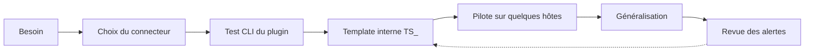

# Démarche de mise en supervision

Une nouvelle ressource ne devrait jamais arriver en production avec des alertes « par défaut ». Voici le déroulé que je suis.



## 1. Qualifier le besoin

- Que doit-on détecter, et **quelle action** déclenche chaque alerte ?
- Qui est notifié, à quelles heures, avec quelle escalade ?
- Quel mode de collecte est possible : SNMP, agent, API, protocole applicatif ? Quelles contraintes réseau et sécurité (flux, comptes de service) ?

!!! tip "Agent ou pas agent ?"
    Pour les serveurs Linux et Windows, privilégier le [Centreon Monitoring Agent](agent-cma.md) : contrôles natifs, flux gRPC chiffré, et migration possible depuis NRPE / NSClient++. Garder SNMP pour le réseau et le matériel, l'API pour le cloud et les applications.

## 2. Choisir le Monitoring Connector

Partir du connecteur officiel quand il existe : il fournit le plugin, les commandes et les templates. Le catalogue compte **747 connecteurs** (octobre 2026), installés depuis le gestionnaire de connecteurs de l'interface.

- [Catalogue filtrable par catégorie](https://download.centreon.com/fr/) (onglet *Connecteurs*)
- [Documentation des Monitoring Connectors](https://docs.centreon.com/pp/integrations/plugin-packs/getting-started/introduction/)

Si aucun connecteur n'existe, un plugin maison compatible Nagios reste possible, exécuté par le poller ou par l'agent CMA.

## 3. Tester le plugin en ligne de commande

Toujours valider le plugin **depuis le poller qui supervisera la ressource**, avec l'utilisateur `centreon-engine`, avant toute configuration dans l'interface. Les options exactes sont propres à chaque connecteur : elles sont documentées sur sa page et visibles avec `--help`.

```bash
su - centreon-engine -s /bin/bash -c \
  "/usr/lib/centreon/plugins/centreon_linux_snmp.pl --plugin=os::linux::snmp::plugin --list-mode"
```

Vérifier : la sortie, les métriques de performance, les unités et le temps d'exécution.

## 4. Créer le template de service interne

Un template `TS_` hérite du template éditeur et porte les seuils par défaut dans les macros de service. Voir [Organisation des templates](templates.md) et [Seuils et notifications](seuils-et-notifications.md).

## 5. Piloter, puis généraliser

Appliquer d'abord sur quelques hôtes représentatifs, observer deux à quatre semaines, ajuster, puis déployer progressivement.

## 6. Brancher les intégrations

Avant la mise en production, valider le chemin complet de l'alerte : notification, ouverture de ticket ITSM, diffusion éventuelle vers un SIEM ou une plateforme d'astreinte. Voir [Intégrations](integrations.md).

## 7. Faire vivre la configuration

Revoir régulièrement les alertes qui ne déclenchent aucune action : soit le seuil est mal placé, soit l'alerte doit disparaître.
