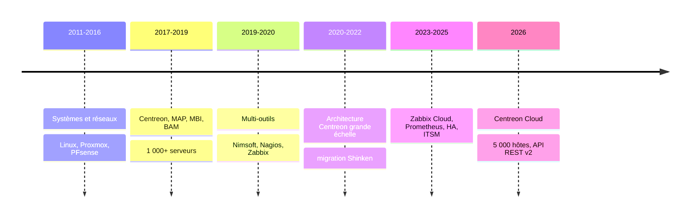

# Réalisations

L'évolution de mes projets et de mes compétences, du plus récent au plus ancien.

!!! tip "Ajouter une réalisation"
    Ajouter une ligne en haut du tableau et, si le projet le mérite, une section détaillée en dessous.

| Période | Réalisation | Compétences mobilisées | Résultat |
|---|---|---|---|
| 2026 → | Migration Centreon On-Premise → Centreon Cloud (Eiffage) | API REST v2, Plugin Packs, NRPE, NSClient++, OpenTicket → EasyVista | 5 000 hôtes et 26 000 services migrés, sondes custom remplacées par des connecteurs officiels |
| 2025 | Refonte de la plateforme Centreon (Dior) | MAP, MBI, BAM, sondes Bash, reporting SLA | Plan de migration avec run en parallèle, recettes pilotées |
| 2023 – 2025 | Migration Centreon → Zabbix Cloud (Docaposte) | Zabbix, Prometheus, HA, Jira, GLPI | Modèle de supervision commun : templates, triggers et politique d'alertes |
| 2021 – 2022 | Migration Shinken → Centreon et migration datacenter (GRDF) | Architecture cible, pilotage Agile, MAP, MBI, BAM | Équipes formées, reporting SLA en place |
| 2020 – 2021 | Optimisation Centreon grande échelle (SNCF) | Architecture, modélisation des surveillances | Plateforme optimisée |
| 2020 | Supervision Zabbix et industrialisation de la production (Huawei) | Zabbix, ITIL | Indicateurs ITIL et normes d'exploitation |
| 2019 – 2020 | Supervision Nimsoft (BNP Paribas) | Nimsoft, Nagios, Thruk | MCO et optimisation |
| 2017 – 2019 | Référent supervision (Econocom) | Centreon, MAP, MBI, BAM, Bash, iTop | Plus de 1 000 serveurs mis en supervision, dashboards SLA |
| 2011 – 2016 | Technicien maintenance informatique | Linux, Proxmox, PFsense, GLPI, EON | Socle systèmes et réseaux |

## Évolution des compétences

## Détail des projets

### Migration Centreon On-Premise → Centreon Cloud — 2026

**Enjeu** : basculer une plateforme Centreon 21.10 de 5 000 hôtes et 26 000 services vers Centreon Cloud sans perte de supervision.
**Ma contribution** : cartographie de l'existant, migration des ressources via l'API REST v2, ouverture des flux pollers → Cloud, run en parallèle, rationalisation du catalogue de templates, alerting unifié vers EasyVista.
**Résultat** : à compléter (délais, réduction des alertes UNKNOWN, nombre de sondes custom supprimées).
